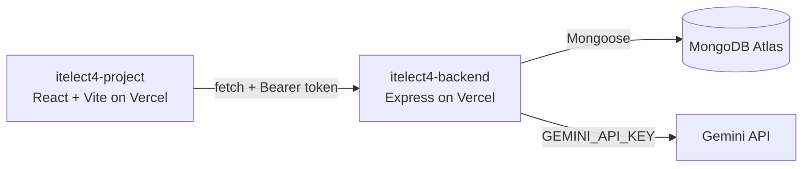

# Shoot Tracker (itelect4-project)

[](https://github.com/KennethCyrilPimentel/itelect4-project-IT4B/actions/workflows/ci.yml)

Frontend for **Shoot Tracker**, a photography booking app: request a shoot, track its status, and see the deliverables (photo batches) for each shoot. There is also an AI Review page that turns a shoot description into a shot list and prep tips. Built with React, TypeScript and Vite, and connected to a real API.

## Live links

- **Live frontend:** https://itelect4-project-it-4-b-mu.vercel.app
- **Live backend (API):** https://itelect4-backend-eta.vercel.app
- **Backend repo:** https://github.com/KennethCyrilPimentel/itelect4-backend

## Architecture



The browser only talks to the backend. The backend talks to the database and to Gemini, so no secret keys ever reach the browser.

## Features

- Register and log in with a real account (JWT token from the backend)
- Request a shoot with a validated form (React Hook Form + Zod) and see only your own shoots
- Shoot detail page and a deliverables page
- AI Review page: describe a shoot and get a summary, shot list, prep tips and a difficulty rating from Gemini
- Protected routes: shoots, deliverables and the AI Review need a login
- Dark mode

## Built with

React, TypeScript, Vite, React Router, TanStack Query, Zustand, React Hook Form, Zod, Tailwind CSS and shadcn/ui. Tested with Vitest and Testing Library.

## Run it locally

```
npm install
npm run dev
```

Create a `.env.local` file in the project root with:

```
VITE_API_URL=https://itelect4-backend-eta.vercel.app/api
```

The app runs on http://localhost:5173. To build for production, run `npm run build`.

## Tests and CI

`npm test` runs 7 Vitest tests in a simulated browser:

- `ShootCard`: shows the type, location and a readable status, and hides the location in the compact variant
- `useToggle`: starts at the given value and flips it each time it is called
- `ReviewPage`: shows the schema's error message for a bad description and sends no request to the API

GitHub Actions (`.github/workflows/ci.yml`) installs the packages, runs the tests and builds the app on every push.

## Deployment

Deployed on Vercel. `VITE_API_URL` is set as an environment variable there, and `vercel.json` sends every path to `index.html` so refreshing on a page like `/shoots` works.

## AI-use disclosure

I used Claude (Anthropic) as a coding assistant while building this project: explaining concepts, helping debug errors, and suggesting code that I then ran, tested and adapted to my own app. The AI Review page is also an AI feature itself: it sends the description to my backend, which calls Google's Gemini and validates the reply.